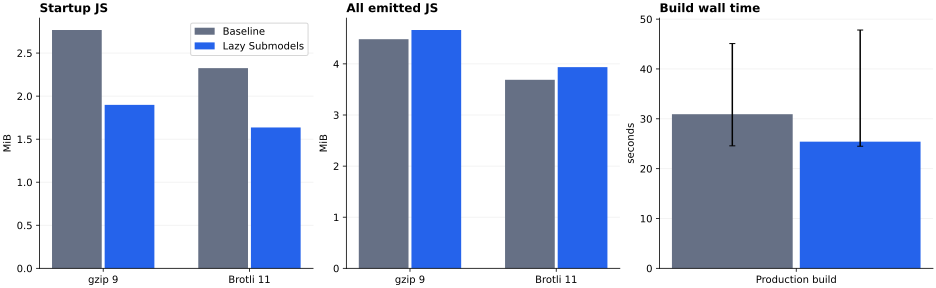
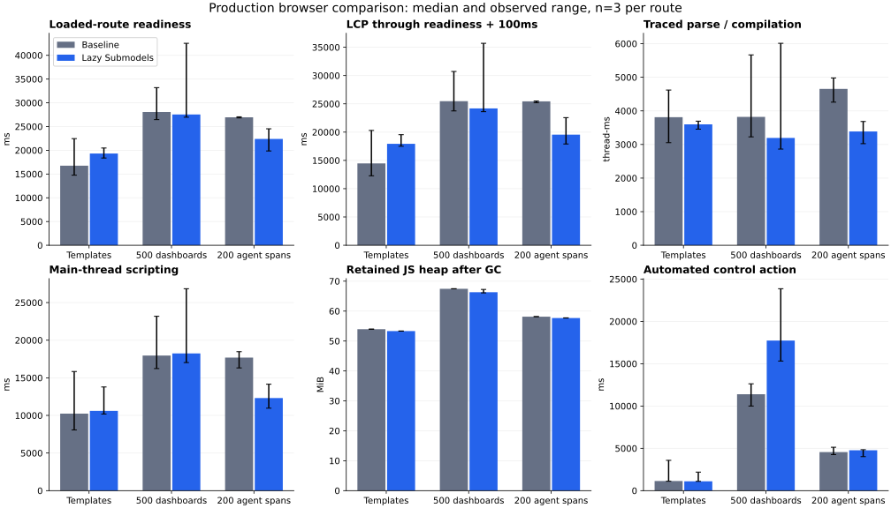
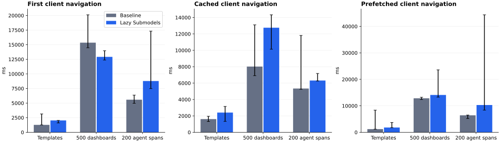

# Automatic route splitting: measured comparison

This comparison uses 69 complete lazy pages and 11 retained eager pages. The generated catalog replaces per-page handwritten imports.

Framework source: `1ef1c4f7aef25af7e24a09b27048238c2a27fa5d`, based on upstream Foldkit `a471adb2` (v0.170). Maple baseline: `084ee139d0ad63e563820f547016fccbab4c3f43`.

Measured Maple application: `484e997690ab3282819bdddc17786c4137257cef`. The later evidence commit does not change application code.

Initial JavaScript falls 31.4% gzip and 29.7% Brotli. Total emitted JavaScript grows 4.0% gzip. The heavy route improves, while lightweight readiness and cached navigation regress in these samples.

## JavaScript and build results

Compression is independent per file. Startup follows the emitted document's static import closure. Total includes JavaScript workers.

| Metric                           |          Baseline |    Lazy Submodels | Change |
| -------------------------------- | ----------------: | ----------------: | -----: |
| Initial JS raw (bytes)           |        10,722,884 |         7,068,134 | -34.1% |
| Initial JS gzip (bytes)          |         2,902,002 |         1,990,427 | -31.4% |
| Initial JS brotli (bytes)        |         2,438,344 |         1,715,174 | -29.7% |
| Initial JS chunks (files)        |               373 |               348 |  -6.7% |
| Total JS raw (bytes)             |        16,698,052 |        16,968,796 |  +1.6% |
| Total JS gzip (bytes)            |         4,700,695 |         4,888,905 |  +4.0% |
| Total JS brotli (bytes)          |         3,868,312 |         4,128,172 |  +6.7% |
| Total JS chunks (files)          |               461 |               643 | +39.5% |
| Build seconds, median [min, max] | 30.9 [24.6, 45.1] | 25.4 [24.5, 47.8] |    n=3 |

## Browser results

Each cell is the median [minimum, maximum] of three runs. Samples use fresh browser contexts. Cached navigation retains the module cache.

| Route           | Metric                                 |                   Baseline |             Lazy Submodels |
| --------------- | -------------------------------------- | -------------------------: | -------------------------: |
| Templates       | Loaded-route readiness (ms)            | 16759.0 [14754.4, 22456.8] | 19322.1 [18367.7, 20479.3] |
| Templates       | LCP (ms)                               | 14476.0 [12284.0, 20300.0] | 17936.0 [17504.0, 19548.0] |
| Templates       | Main-thread script time (ms)           |  10234.3 [8077.4, 15839.5] | 10602.4 [10187.1, 13780.0] |
| Templates       | Retained heap (MiB)                    |          54.0 [53.9, 54.0] |          53.3 [53.3, 53.3] |
| Templates       | Traced parse / compilation (thread-ms) |    3812.3 [3054.0, 4620.3] |    3598.8 [3455.3, 3693.7] |
| Templates       | Automated control action (ms)          |    1141.3 [1114.5, 3582.6] |    1106.6 [1099.4, 2191.1] |
| 500 dashboards  | Loaded-route readiness (ms)            | 28059.2 [26454.4, 33193.8] | 27545.9 [26963.6, 42525.5] |
| 500 dashboards  | LCP (ms)                               | 25464.0 [23752.0, 30716.0] | 24192.0 [23608.0, 35696.0] |
| 500 dashboards  | Main-thread script time (ms)           | 17964.3 [16228.1, 23181.5] | 18238.4 [17024.9, 26846.5] |
| 500 dashboards  | Retained heap (MiB)                    |          67.5 [67.5, 67.5] |          66.3 [66.1, 67.2] |
| 500 dashboards  | Traced parse / compilation (thread-ms) |    3820.1 [3226.3, 5666.4] |    3194.6 [2863.2, 6010.4] |
| 500 dashboards  | Automated control action (ms)          | 11391.1 [10003.7, 12627.5] | 17738.4 [15316.5, 23865.4] |
| 200 agent spans | Loaded-route readiness (ms)            | 26948.6 [26813.4, 27057.2] | 22389.9 [19853.7, 24528.6] |
| 200 agent spans | LCP (ms)                               | 25436.0 [25188.0, 25504.0] | 19556.0 [17904.0, 22564.0] |
| 200 agent spans | Main-thread script time (ms)           | 17687.4 [16317.0, 18475.0] | 12313.2 [10959.7, 14149.6] |
| 200 agent spans | Retained heap (MiB)                    |          58.1 [58.1, 58.1] |          57.7 [57.7, 57.7] |
| 200 agent spans | Traced parse / compilation (thread-ms) |    4653.5 [4259.9, 4980.5] |    3387.6 [3023.7, 3683.5] |
| 200 agent spans | Automated control action (ms)          |    4555.1 [4262.0, 5131.8] |    4769.5 [4015.5, 4835.9] |

## Navigation results

Navigation uses the real document click handler. The harness refuses a document reload during client navigation.

| Destination     | Visit      |              Baseline (ms) |        Lazy Submodels (ms) |
| --------------- | ---------- | -------------------------: | -------------------------: |
| Templates       | first      |    1270.2 [1262.0, 3143.3] |    2029.5 [1603.5, 2042.2] |
| Templates       | cached     |    1612.4 [1313.5, 1949.0] |    2406.5 [1333.6, 3152.2] |
| Templates       | prefetched |    1203.6 [1171.2, 8370.9] |    1805.2 [1744.6, 3707.0] |
| 500 dashboards  | first      | 15352.5 [14473.5, 20122.0] | 12918.9 [12377.7, 13970.6] |
| 500 dashboards  | cached     |   8018.0 [6901.0, 13110.0] | 12759.7 [10133.4, 14331.5] |
| 500 dashboards  | prefetched | 12851.3 [12390.6, 13233.6] | 14098.4 [13290.9, 23572.1] |
| 200 agent spans | first      |    5584.1 [4969.1, 6364.3] |   8779.5 [7481.9, 17321.2] |
| 200 agent spans | cached     |   5338.1 [5248.0, 11810.3] |    6315.1 [6261.9, 7172.9] |
| 200 agent spans | prefetched |    6422.1 [5207.0, 6523.3] |  10305.7 [8386.0, 44377.0] |

## Additional route payload

The baseline includes these implementations in startup. The additional lazy payload follows all route imports and excludes startup files.

| Route         | Extra files | gzip bytes | Brotli bytes |
| ------------- | ----------: | ---------: | -----------: |
| Templates     |           4 |     12,304 |       11,109 |
| Dashboards    |           4 |     14,232 |       12,820 |
| Agent session |           6 |     44,775 |       39,680 |

The implementation payload follows static imports. Further conditional dynamic imports and workers are outside that closure; all emitted JavaScript is included in total output. The browser samples record what each representative cold load actually requests.

| Cold route      | Baseline observed gzip JS bytes | Lazy observed gzip JS bytes |
| --------------- | ------------------------------: | --------------------------: |
| Templates       |                       3,020,352 |                   2,128,804 |
| 500 dashboards  |                       2,971,379 |                   2,074,035 |
| 200 agent spans |                       2,971,379 |                   2,104,578 |

Observed bytes use native document Resource Timing encoded body sizes, without response headers. They include dynamic JavaScript requested through readiness, beyond the static startup closure.

## Interpretation and regressions

The heavy route's median readiness changes from 26.9s to 22.4s (-16.9%). Its observed readiness ranges do not overlap. Median main-thread script time falls 30.4%.

The lightweight route's median readiness rises from 16.8s to 19.3s (+15.3%). Its ranges overlap. Dense-route readiness changes little at the median, with a slower optimized outlier.

All three cached-navigation medians increase. Prefetched-navigation medians also increase, including a heavy-route outlier of about 44s. The outlier is retained in the range and raw samples. The dense route's automated action duration also increases, with non-overlapping observed ranges; this does not establish filtered-table completion latency. Retained heap falls only about 1–2%; code splitting provides little retained-memory benefit for these loaded routes.

The code explains costs that warrant profiling: admission always requires a Command and completion even with warm code; Loading can produce an intermediate render; the compatibility adapter adds a Submodel view boundary; and a cold route implementation starts loading after route entry. Prefetch waits for its entry response and at least 1,200ms, which does not guarantee that all transitive module evaluation has completed. These mechanisms are established by the implementation. This experiment does not assign a causal share of the timing regression to each one.

Keep the deterministic admission protocol. Follow-up performance work should profile the compatibility view boundary, render scheduling around warm admission, and the initial-route loading waterfall. Smaller startup bytes alone do not establish a uniformly faster router.

The dense timed action fills and clears the search field, but its row-presence waits do not prove that filtering completed before reset. Its duration is an automation metric, not filter-render latency. Separate production-browser checks verify that a nonmatching row disappears and returns after reset on both artifacts. Templates and span selection already wait for changed visible content or selection state.

## Dependency inspection

A supplemental build emits the module/package graph. Its 643 JavaScript files are byte-identical to the measured optimized artifact. The emitted graph contains one physical Effect 4.1.2 instance. The only package with multiple emitted versions is d3-array (2.12.1 and 3.2.4), both present in the unchanged lockfile. Together those modules have 9,791 bundler-reported rendered bytes before output minification.

Large retained startup modules include the generated icon collection (479,485 rendered bytes), the SDK flushable client (117,718), Electric's client chunk (113,469), the xyflow system module (105,879), and the domain query API descriptor (87,850). These are pre-minification attribution figures, not compressed payload measurements. The chunk/module graph is in `raw/module-graph.json`; `raw/identity-check.json` verifies artifact identity.

## Conditions and limits

- Chromium 155.0.8059.79, Node 24.22.1, Bun 1.4.4, Effect 4.1.2, Vite 8.3.5. The Bun lockfile is unchanged.
- Linux cloud environment with a four-CPU quota. Browser CPU throttling is 4×. Network latency is 40ms, download is 1,500,000 bytes/s, and upload is 750,000 bytes/s.
- Viewport is 1440×1000, locale is en-US, timezone is UTC. Date is fixed at 2026-11-04T12:00:10Z with a Date-only wrapper. Performance APIs, observers, and timers remain native.
- Static files use gzip level 9. The server precompresses files before measurements. API responses use local deterministic fixtures. No live warehouse or hosted service participates.
- Default production telemetry and replay remain enabled in both artifacts. The fixture server intercepts their ingestion requests, but recorder CPU work remains part of the workload. No real telemetry is sent.
- The lightweight route has an empty template inventory. The dense route receives 500 dashboard rows. The heavy route receives 200 AI spans and opens Flow.
- A separate 1,000-span pilot exposed substantial Flow layout cost. Its observation is retained in the raw pilot log and excluded from this comparison.
- An earlier fixed-clock pilot suppressed resource timings. It is excluded. Both final variants were rerun with native timing APIs; the harness now rejects missing JavaScript resource timings.
- Readiness requires loaded route content and two animation frames. This is a readiness proxy, not an INP measurement. Automated control actions follow the cold phase.
- LCP records browser candidates through readiness plus 100ms. Script time uses CDP ScriptDuration. Parse/compilation sums non-overlapping elapsed trace intervals per thread, including background compiler work; this is not process CPU time.
- Heap measurements force GC after the timed cold phase. This is JavaScript heap, excluding native DOM, GPU, and other process memory. The raw data also retains uncollected heap samples and resource timings.
- Prefetch receives at least 1,200ms of lead time and waits for the implementation response. Lead times are recorded. Cached visits refer to module reuse; Playwright request routing disables HTTP cache.
- Builds and browser measurements run without concurrent builds, tests, or compression jobs. Three samples reveal observed variability and do not establish tail latency or statistical significance.
- Baseline runs precede optimized runs. This order does not control all host scheduling or thermal variation. Timing differences with overlapping ranges need caution.

## Scope and architectural assessment

Explicit contracts make discovery and typed import generation automatic. They also expose shared execution that prevents safe splitting. Schemas and shared runtime remain eager.

Five retained pages need a prepared-data protocol. Shared embedded flows and Settings/MCP retain eager execution. The AlertEditor key needs an explicit boundary. These constraints preserve existing behavior.

The host preserves Model–Message–Update composition through preparation facts. It owns a per-application code cache, instance guards, retry attempts, parked revival, and explicit restoration barriers.

Runtime resumption reconstructs interrupted host preparation. Applications still own interrupted data Commands within admitted children. Development edits reset saved lazy state across build identities. Separate SSR/client identity coordination remains future integration work.

The next API boundaries are prepared data with cache holding/release, asynchronous decoding that retains child validation, shared embedded Submodels, and earlier route-code preparation. View composition and warm-admission scheduling also need performance work. The current APIs establish typed ownership and admission; they do not automate those further protocols.

Browser recovery reloads the document because Chromium retains failed import records. This loses transient parked state. The failure UI explains that behavior.

This report does not establish competitiveness with TanStack Start. A valid comparison requires the same application, data, rendering work, and server conditions. Remaining eager schemas and API descriptors still consume substantial startup JavaScript.

## Reproduction

See [the benchmark procedure](../../../apps/web/perf/README.md). Raw build logs, manifests, compression results, browser samples, and verification results are adjacent in `raw/`. [Verification and review](verification.md) records test scope, independent reviews, and publication requirements.
